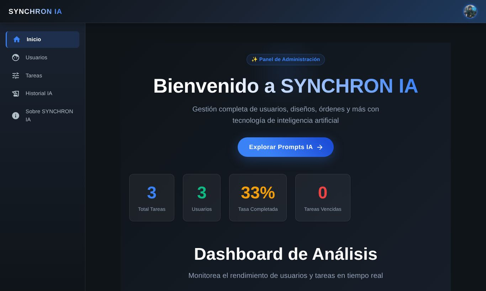
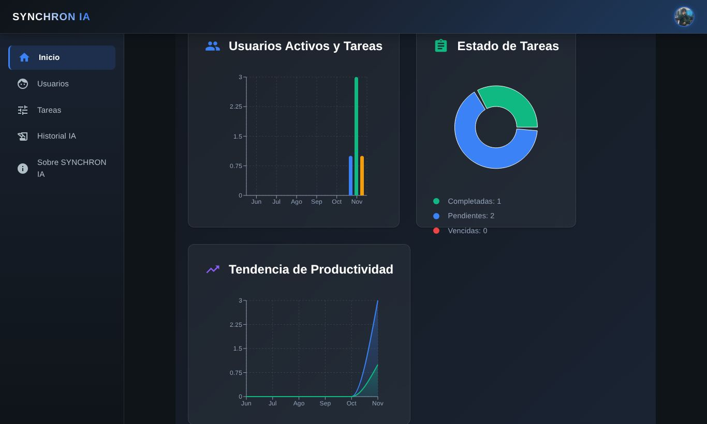
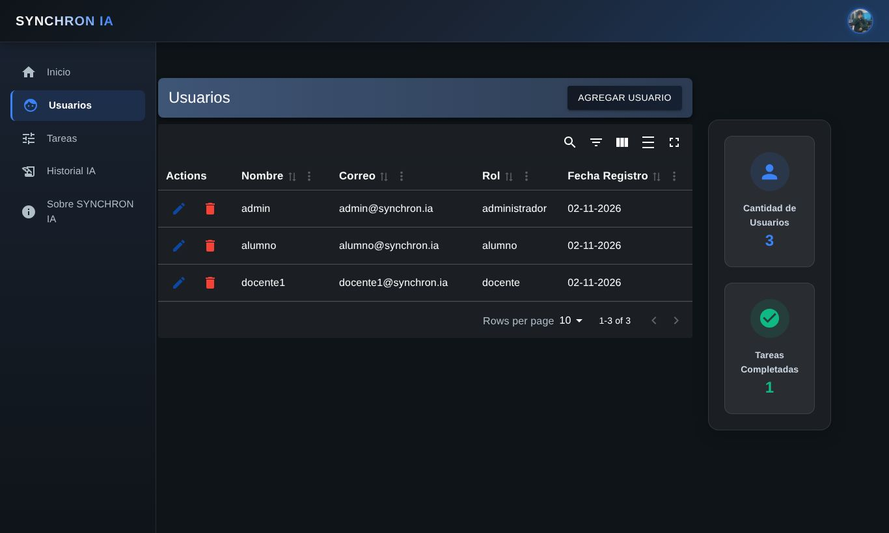

# SYNCHRON IA · Panel de administración

Panel web para administrar **SYNCHRON IA**, una app de productividad estudiantil con asistente de IA: usuarios y roles, tareas y el historial de conversaciones con la IA. Está hecho con **React 19 + Vite + Material UI** y consume una API REST en **Django REST Framework** con JWT ([haroldcutti/Seitas](https://github.com/haroldcutti/Seitas)).



## Funcionalidades

- **Login con JWT.** Solo pueden entrar administradores. El token se envía en cada petición con un interceptor de Axios.
- Rutas públicas, privadas y protegidas, más registro inicial de administrador.
- **CRUD de usuarios** con roles (administrador, docente, alumno).
- **CRUD de tareas** con prioridad, tipo y estado.
- **Historial de IA** (pregunta, respuesta, usuario y fecha).
- **Dashboard con datos reales de la API:** totales, tasa de tareas completadas, tareas vencidas y gráficos por mes con Recharts.
- Formularios validados con React Hook Form y Yup, y tablas con Material React Table (filtros, orden y paginación).

| Dashboard | Usuarios |
|---|---|
|  |  |

## Stack

React 19 · Vite · Material UI 7 · React Router 7 · Axios · React Hook Form + Yup · Material React Table · Recharts · Day.js

## Cómo correrlo

1. Levanta la API ([Seitas](https://github.com/haroldcutti/Seitas)) y carga los datos de prueba con `python manage.py seed_demo`.
2. En este repo:

```bash
cp .env.example .env    # URL de la API
npm install
npm run dev             # http://localhost:5173
```

Usuario de prueba: `admin@synchron.ia` / `admin1234`

| Script | Qué hace |
|---|---|
| `npm run dev` | Servidor de desarrollo |
| `npm run build` | Build de producción |
| `npm run lint` | ESLint |

## Estructura

```
src/
├── components/
│   ├── admin/         # Login, registro y guards de rutas
│   ├── usuarios/      # CRUD de usuarios
│   ├── tareas/        # CRUD de tareas
│   ├── historial_ia/  # Historial de conversaciones con la IA
│   ├── Axios.jsx      # Instancia de Axios con JWT
│   └── Home.jsx       # Dashboard
└── services/authService.jsx
```

## Equipo

Proyecto en equipo. Frontend: **[Brian Saavedra](https://github.com/briansaa)**. Backend: [haroldcutti](https://github.com/haroldcutti).
